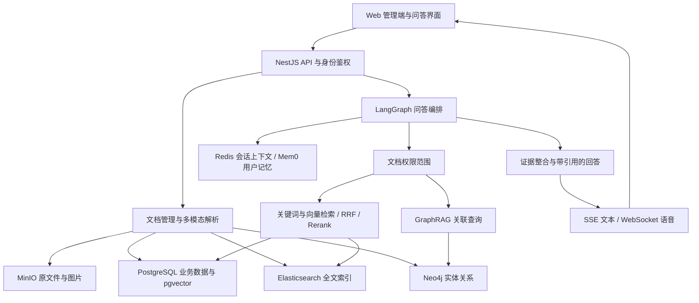

# 企业多模态知识库与智能问答平台

面向企业内部培训、业务答疑与跨部门知识检索，设计统一管理制度文档、业务案例、图片及音视频资料的知识平台，目标是提供带来源引用的文本与语音问答。

**当前状态：架构设计与原型开发。** 已完成需求梳理和技术选型；NestJS 流式问答、GraphRAG、ASR/TTS 等独立原型位于[学习仓库](https://github.com/Drb-code-ing/WROKSPACE)。平台集成尚未完成，下文描述的是新项目的目标架构，不代表全部功能已经实现。

仓库地址继续使用 [`Drb-code-ing/docresearch-agent`](https://github.com/Drb-code-ing/docresearch-agent)，不另建或重命名仓库。当前 `src/docresearch/`、`tests/` 与 Python CLI 是保留的旧版 DocResearch；其运行方式见[旧版说明](docs/LEGACY_DOCRESEARCH.md)。

## 业务场景

以销售培训与售后答疑为例：制度、产品手册、案例图片和培训录音分散存放，员工查找资料依赖关键词和反复询问；不同部门又不能共享全部资料。

平台围绕三类工作展开：

- **管理资料：** 上传、分类、解析与更新文档，维护所属部门、可见范围及处理状态。
- **查找答案：** 根据问题检索有权限的资料，结合正文与实体关系组织答案，附上可回看的来源。
- **连续交互：** 支持追问与语音输入输出，在权限范围内使用会话上下文和用户偏好。

## 功能设计

| 模块 | 目标能力 | 主要技术 |
| --- | --- | --- |
| 文档与多模态入库 | 文本类文件、图片、音频及视频统一解析，保留原文件与来源信息 | LangChain Loaders、OCR/视觉理解、ASR、视频分片、MinIO |
| 智能检索与问答 | 关键词与语义召回、融合重排、按资料作答与引用 | Elasticsearch、PostgreSQL/pgvector、RRF、Rerank |
| 知识图谱 | 从文档抽取实体关系，支持关联查询与多跳检索 | Neo4j、Cypher、LangGraph |
| Agent 编排 | 根据问题选择检索工具，必要时分解复杂任务并检查证据 | LangChain、LangGraph；DeepAgents 作为复杂任务扩展选型 |
| 权限与记忆 | 功能权限、文档可见范围、会话上下文与用户偏好 | NestJS、PostgreSQL、RBAC、Redis、Mem0 |
| 交互与观测 | 流式文本、语音交互、固定测试集评估与调用链排障 | Vercel AI SDK、SSE、WebSocket、腾讯云 ASR/TTS、LangSmith/OpenEvals、Langfuse |

## 目标架构

### 存储分工

| 存储 | 保存什么 | 不负责什么 |
| --- | --- | --- |
| PostgreSQL + pgvector | 用户、角色、文档元数据、权限关系、文本片段及向量 | 不把向量相似度当成事实正确性的证明 |
| Elasticsearch | 文档分片的全文索引与 BM25 召回 | 不作为权限规则的唯一事实来源 |
| Neo4j | 实体、关系及其关联的来源文档 | 不代替原文证据，也不能绕过文档权限 |
| MinIO | 原始文件、文档图片及其他媒体对象 | 不承担关键词或向量检索 |
| Redis | 按用户和会话隔离的近期对话上下文 | 不充当永久业务数据库 |
| Mem0 | 按用户范围召回的长期偏好与历史摘要 | 不将个人记忆当成企业制度或授权依据 |

新平台统一选择 **PostgreSQL + pgvector**，不再并行引入 Milvus。理由是复用业务数据库管理分片、元数据及向量，减少首版组件数量；Elasticsearch 继续负责全文检索，Neo4j 负责关系查询。旧 Python 代码中的 Milvus 属于历史实现，不是新平台的向量库选型。

### 一份资料如何进入知识库

1. 用户上传资料；NestJS 校验身份、文件类型和可见范围，原文件保存至 MinIO。
2. 按类型选择解析器：文本文件提取正文；图片执行 OCR/视觉理解；音频执行 ASR；视频分片提取音频和画面信息。
3. 统一整理为 Markdown 与附件引用，分片时保留文档、页码或时间段等来源信息。
4. 分片生成向量存入 pgvector，同时写入 Elasticsearch；实体和关系按来源归入 Neo4j。
5. 更新文档处理状态。只有解析及目标索引满足可用条件的资料，才参与后续问答。

原文件、解析文本、检索分片与图谱证据使用文档 ID、片段 ID 关联；存储介质不同，来源身份保持一致。文件更新、删除与权限变更时，需要同步相关索引并更新文档处理状态，这部分纳入平台集成与验收。

### 一次问题如何得到回答

1. 接收文本问题，或通过 ASR 将录音转换为文本。
2. 根据登录身份确定可访问的文档范围，加载当前会话与相关用户记忆。
3. 由 LangGraph 编排问题判断与检索工具调用：一般资料问题走混合检索，涉及关联关系时调用图谱查询；复杂问题再考虑任务分解，不强制每次派发子 Agent。
4. 在权限范围内执行 pgvector 与 Elasticsearch 双路召回，按片段 ID 去重，经 RRF 融合、Rerank 排序；必要时加入有来源的图谱查询结果。
5. 检查证据能否回答问题；缺少依据时补充检索或说明无法确认，不凭记忆补造业务事实。
6. 将答案与来源引用通过 SSE 增量返回；语音模式再将文本片段送入流式 TTS，经 WebSocket 返回音频。

检索返回的片段可以直接作为回答上下文；查看完整文件是追溯证据的可选动作，不要求每次命中后再读一遍原文件。

### 权限如何进入检索

- **功能权限：** 用户、角色与权限关联控制页面、菜单、按钮和服务端接口；前端隐藏按钮不能代替后端鉴权。
- **数据权限：** 在全文、向量与图谱查询前限定可见资料，禁止先把无权限内容送给模型，再在最终答案里删除。
- **图谱权限：** 实体关系必须关联来源，查询路径中的证据也要满足可见范围，避免通过关联关系泄露受限资料。
- **原文件访问：** 引用预览和文件下载重新校验权限；MinIO 对象不能仅靠一个公开 URL 暴露。
- **记忆隔离：** Redis 会话键与 Mem0 检索范围绑定用户身份；记忆不能扩大用户的文档访问权限。

### 流式交互与模块边界

NestJS 负责接口、鉴权与模型 Provider 注入；LangChain 组装模型链，LangGraph 管理问答状态和工具路由。DeepAgents 保留为复杂调研任务的扩展，不替代普通问答的全部流程。

文本增量使用 SSE，音频增量使用 WebSocket。现有 NestJS 原型输出普通 SSE 文本事件；接入 Vercel AI SDK 时还需要适配其流协议与消息状态，不能直接将当前接口称为完整聊天集成。

当前 ASR、TTS 与 SSE 问答是独立原型。录音上传、ASR 结果进入检索、引用返回、音频播放与中断控制尚未串成端到端流程。

### 评估与可观测性

- **开发与实验：** 选用 LangSmith / OpenEvals，使用固定问题集比较检索和回答，区分检索相关性、回答忠实度与帮助性；不能把这三个评分直接称为答案正确率。
- **运行排障：** 规划接入 Langfuse，关联一次请求的检索、模型与工具调用，记录耗时、token usage、错误及估算成本。
- **验收边界：** 学习仓库有评估示例，但本平台没有集成评估执行器或 Langfuse，也没有可报告的实验成绩、线上流量和性能提升。
- **资料保护：** 后续观测接入需要决定脱敏、采样与保留策略，不默认向外部平台记录完整原文或用户私密内容。

## 已有原型与实现边界

下表引用学习仓库中的历史提交，说明各个部件的来源；它们不是本仓库已集成的新平台服务。本次文档整理没有重新运行付费 API。

| 内容 | 已有材料 | 尚缺什么 |
| --- | --- | --- |
| 产品需求、选型与 RBAC 数据设计 | [知识库规划笔记](https://github.com/Drb-code-ing/WROKSPACE/blob/4fe6191/ai/project/company_knowledge/readme.md)，`0c198e1`、`a0554d7`、`769ef45`、`ea40aad` | 正式 schema、迁移、鉴权、权限管理与管理端 |
| NestJS 流式问答 | [AI 模块](https://github.com/Drb-code-ing/WROKSPACE/tree/4fe6191/ai/agent/asr_tts/asr-and-tts-nest-service/src/ai)，`4fe6191`；工厂 Provider、LangChain stream、async generator 与 SSE | 当前是通用模型问答，没有检索、引用、鉴权或平台数据接入 |
| GraphRAG | [四节点示例](https://github.com/Drb-code-ing/WROKSPACE/blob/58d6395/ai/agent/graph_rag/neo4j-graphrag/src/graphrag.mjs)，`58d6395`；问题解析、Cypher 生成、执行与回答 | 当前使用奶茶样例图谱；缺少企业文档实体抽取、混合检索融合和权限控制 |
| 单句 ASR 与流式 TTS | [语音脚本](https://github.com/Drb-code-ing/WROKSPACE/tree/6760908/ai/agent/asr_tts/tts-stt-test/src)，`b5c5376`、`6760908` | 缺少 NestJS ASR 后端与文本/音频端到端交互集成 |
| RAG 量化评估 | [LangSmith 学习示例](https://github.com/Drb-code-ing/WROKSPACE/tree/2e6d82a/ai/agent/langsmith-demo/rag-demo)，`2e6d82a` | 缺少新平台 Target、固定测试集实验及可核查结果 |
| 多模态、权限、记忆与观测 | 目标方案中的 MinIO、RBAC、Redis/Mem0、Langfuse | 这些平台模块尚未集成，不能写成已经落地的能力 |

## 实施顺序

1. **文本资料闭环：** NestJS 服务、身份鉴权、文档管理、MinIO、文本解析与 pgvector 入库。
2. **带权限的混合问答：** Elasticsearch、RRF/Rerank、检索前过滤、SSE 与来源引用；先能从文本资料正确作答。
3. **关系查询：** 企业文档实体抽取、Neo4j 入库、受权限约束的图谱检索，并与混合检索结果整合。
4. **多模态与语音：** 图片/OCR、音频转录、视频分片；接入 ASR/TTS 和前端播放、中断流程。
5. **会话与效果迭代：** Redis/Mem0、LangSmith 固定集评估、Langfuse 观测，补齐更新删除与跨索引一致性检查。

每一步都以可运行的业务闭环为边界，再增加下一类能力。当前没有可供启动新平台的一键部署命令，也未建立新平台的 CI；现有 `uv` 命令和 GitHub Actions 只对应旧版 Python 项目。

## 旧版代码与文档

旧版实现及其学习资料继续保留，入口如下：

| 路径 | 对应内容 |
| --- | --- |
| `src/docresearch/`、`tests/`、`examples/`、`pyproject.toml` | 原 DocResearch 的 Python 工具循环、文件工作区、ES/Milvus 检索和测试 |
| [旧版运行说明](docs/LEGACY_DOCRESEARCH.md) | Python CLI、配置、离线 demo 与真实模型运行方式 |
| [旧版项目理解](docs/PROJECT_UNDERSTANDING.md) / [旧版面试文档](docs/INTERVIEW_GUIDE.md) | 原多 Agent 调研助手的实现，不是新知识库的实现文档 |
| [旧版评估文章](docs/LANGSMITH_RAG_EVALUATION.md) / [旧版验收](docs/VALIDATION.md) | 原项目的评估设计、测试与真实调用证据，不作为新平台的验收结果 |

新平台将沿用旧版在检索、证据引用与受控工具上的设计经验，后续实现按上述业务闭环逐步整合。
